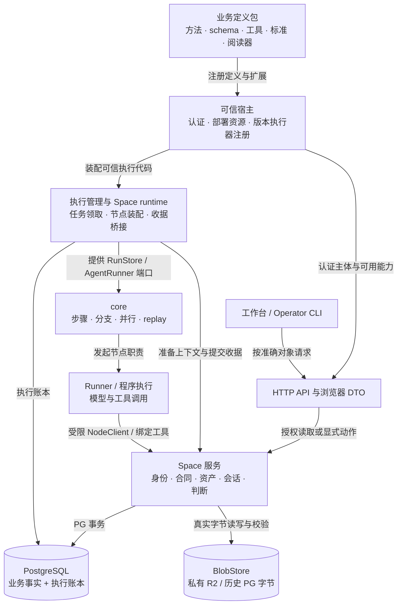

# 系统架构：从准确方法到业务事实

Agent Workflow 要让一套方法实际承担业务，并留下足以判断“发生了什么、产物能否使用、方法该怎样改”的事实。架构因此围绕三件事组织：**准确的方法与输入、受控的节点执行、可追溯的结果与判断。** 工作台、CLI 和执行器通过这三件事协作。

本页是共享系统的技术总览，解释现行模块和必须保持的关系。产品目标与对象含义以[产品定义](product.md)为准，完整产品状态以[建设路线](harness-roadmap.md)为准。详细字段、API、未来协议和历史验收分别进入专题；安装一个包、保存一份响应或展示一张图，都不能独立证明业务已经完成。

## 先用一次业务理解系统

假设要根据一份材料完成一篇稿件。先把材料保存为准确资产版本；选择已经登记且有匹配执行器的方法，固定这次使用的材料。研究节点产生研究，写作节点使用这份研究，审阅者评价准确稿件。遇到失败时，要能分清是材料不足、模型调用失败、结果不符合 schema，还是产物尚未提交。

处理下一次业务时，仍可使用原来的采用版。设计者可以同时根据已有失败研究候选方法，选定条件做比较，再由有权者决定采用与否。**完成一个 Case、修改一条方法、改进共享底座，是不同的工作；它们引用相同事实，却有不同的决定和结束条件。**

这使系统必须回答几个具体问题：

- 这次执行使用哪版方法、哪些准确材料？后来的修改是否会影响历史依据？
- 节点实际收到什么、执行几轮、哪次技术重试失败？这些不是仅靠节点名称能回答的。
- 读到的是正式发布资产、模型原始响应，还是人工修订结果？来源与关系是否有实际收据？
- 用户的评价或采用决定影响哪个准确对象？查看候选会不会改变日常运行的方法？

下面的分层分别承担这些问题。

## 系统组成与控制方向

图中的执行管理和 runtime 属于共享装配能力，core 保持独立。core 通过端口接收存储和 runner，不导入 PostgreSQL、Space、SDK、React 或业务仓库。业务定义不直接成为任意可执行代码：宿主显式登记执行器，按准确方法版本与入口校验部署可用性，才允许发起执行。

Space 服务负责认证主体下的领域授权与写入；HTTP API 再检查请求来源、对象关系及动作能力，返回有界 DTO。浏览器不拿 pool、领域 service、runner 或提供者凭据。图和阅读器呈现已有事实，其布局与页面状态不会改变方法或资产正本。

## 各模块负责什么

| 模块 | 控制的工作 | 向外提供什么 |
| --- | --- | --- |
| `workflow` core | 一次运行中的步骤、分支、并行、校验与可复用结果 | `RunStore`、`AgentRunner` 等执行端口及运行时；独立于基础设施 |
| `workflow-space-contracts` | 系统 schema、业务 schema 登记及冻结的节点存储合同 | 版本／hash、输入输出槽、字段投影、状态和动作约束 |
| `workflow-spaces` 领域服务 | Space 内方法、Case、输入、资产、上下文、会话、评价和采用 | 授权服务、限定 NodeClient、关系查询和业务提交协议 |
| Space runtime / execution manager | 把 core 身份与领域身份对齐；登记任务、领取、心跳和停止 | 受管执行路径、准确上下文、PG 提交桥接及可核查任务状态 |
| `workflow-postgres` | 执行账本和原子步骤收据 | `aw_*` 持久化；可加入 Space 使用的同一 PG 事务 |
| Runner 适配 | 一次 Agent 调用的模型、工具、事件与可获取响应 | 由官方 `@openai/agents` SDK 驱动的 workflow runner；SIWC 仅提供 ChatGPT 授权和受限的自定义 Responses `Model` 传输，不代表覆盖全部 SDK 能力 |
| `workflow-space-api` | 宿主认证后的 HTTP 查询与显式动作 | 浏览器安全 contracts、有界分页、关系验证和错误合同 |
| `workflow-workbench-ui` | 准确对象选择、图、正文与记录阅读，受权动作的交互 | 可复用 React 组件；不直接读取数据库、原始文件或模型凭据 |
| 业务消费者 | 方法代码、角色指令、领域工具、资产正文、标准与阅读语义 | 向共享端口注册 CONTENT 等业务能力；提供部署与身份来源 |

同一 shared package 内仍可包含多个职责，表格不是要求再拆一批包。research、analysis、creation 继续保留各自工作台、业务方法和数据适配。三者的代码接线与 PostgreSQL + 官方 Agents SDK 迁移已完成，旧共享 Codex／SQLite 执行包和 SIWC runner alias 已移除。回归包括 root build、shared 600 项实际 PG 测试、analysis 613 项回归与 9 项定向 Reviewer 修复检查、research 33 项及实际历史导入和 UI 阅读、creation PG 回归与配置迁移。Creation launcher 已切换到新配置，main／first-design 配置和 metadata 均为 `ordinary-content-20261012`，没有新模型运行或方法采用，既有 5 条 run 记录保持不变。单帖新运行和浏览器阅读已完成，候选为 `revised_unverified`；Reviewer 的相矛盾 minor finding 已驳回，独立审阅未通过。只读审计确认先前完整性缺口已修复，仍有少量精度备注，质量调优继续。SQLite 只供明确启动的只读历史导入，不作为新运行 store 或 fallback；历史 Codex trace 由 read-model 只读解码。

## 准确身份怎样连起来

| 对象 | 它固定或记录什么 | 不能拿什么代替 |
| --- | --- | --- |
| Space | 长期业务目的、成员与相关工作范围 | 一次临时 Run 或技术 workspace 字符串 |
| WorkflowVersion + entrypoint | 这一版方法、配置、schema／存储合同、流程声明和代码依据 | 当前同名方法、相同 codeRevision 或最新 Prompt |
| Case + InputManifest | 本次业务要求与准确输入资产版本 | 当前资产 head、按文件修改时间猜出的材料 |
| Run | 执行使用的方法、入口、Case、输入清单和生效配置 | 版本详情页或多个 Case 的合计状态 |
| occurrence / step / attempt | 实际业务节点发生、core 步骤和技术尝试 | 仅凭角色名、时间先后或数组位置推断 |
| NodeContext / session | 某次尝试实际交付的输入投影、指令、配置和可观察事件 | 发布时的声明配置或外部设计 Agent 聊天 |
| AssetVersion | 不可变正文、schema、来源、依赖、附件与准确生产身份 | 原始模型响应、本地路径或人工修稿后的同名文件 |
| Review / comparison / adoption | 判断对象、条件、基线、标准、判者及后续采用决定 | 步骤 succeeded、单份评价或“最新登记版本” |

方法声明描述允许发生什么；运行收据记录实际发生什么；评价与诊断解释事实并形成决定。三者可以关联，不能互相补造。历史字段没保存、trace 被截断或关系没有覆盖时，应保留缺失及范围，而不是套用当前配置补齐。

`WorkflowVersion.id + entrypoint` 解析到冻结的 `workflowId + codeRevision` 和定义，但版本 ID 不等于执行代码身份。`assetId` 的 head、不可变 `AssetVersion.id` 与 core 原生 artifact ID 也不同；runtime 用持久映射连接后两者，不能把任意一种 ID 当另一种使用。

对于一次读者任务，API 应验证整条关系，例如 selected Run 属于该 Space、绑定 selected 方法和入口，selected occurrence 属于该 Run，附件确实属于 selected AssetVersion。单独知道几个合法 ID，并不意味着它们构成合法组合。

## 一次节点执行跨过哪些边界

1. **登记与绑定。** 业务发布方法和已登记 schema；宿主解析准确执行器。Case 输入冻结为 InputManifest，创建或排队一个绑定该清单的 Run。方法采用、方法登记和本次运行分别保存。
2. **准备。** 进入节点时，用该 Run 的准确合同校验输入槽、schema、状态与来源。创建 context、session、step／attempt 关联，记录实际指令和交付的字段视图。限定 NodeClient 或工具交给节点；数据库与提供者凭据留在宿主。
3. **执行与观察。** Runner 在已装配环境中工作，harness 收集可获取的事件、响应和错误。SIWC 路径由官方 `@openai/agents` SDK 的 `Agent`／`Runner.run` 管理轮次、工具派发和对话历史；自定义 SDK `Model` 只负责以 ChatGPT 授权向 Responses 路由传输请求。模型网络调用不靠一个长 PG 事务等待完成；内部推理、未暴露子调用和未启用的云端 tracing 不会自动成为本地完整记录。现有受限 PG workflow trace 仍是本路径的持久记录。
4. **校验与发布。** 原始响应先按其真实来源保存。需要发布资产时，再校验输出槽、正文、依赖和附件；Space 资产、实际绑定、步骤收据与相关 PG 事件在同一事务提交。core 原生 artifact 与 Space 版本有显式映射，不能直接绕过领域提交。
5. **继续工作。** 下游消费已提交的准确版本；工作台与 CLI 读取同一内容和关系。评价和人的接受是独立动作；一次提交成功不能替代这些决定。

原始 Agent 调用和随后程序发布可为不同步骤。程序校验或发布失败时，Agent 响应仍可能存在；页面需要分别显示它们，不能把程序节点写成模型调用，也不能把未发布响应画成正式资产。

完整执行、重试与恢复机制见[执行 harness 与执行器](postgres-sdk-plan.md)，领域绑定见[Space 与节点合同](workflow-spaces.md)，实际流程与资产关系见[方法、执行与资产](workflow-process-assets.md)。

## 三条一致性边界

**PG 内部。** 执行账本 `aw_*` 和业务领域 `ws_*` 通过准确 ID、约束与共享事务协作。Node 结果提交可以把资产版本、依赖、输出绑定、会话事件及步骤收据一起保存。幂等键约束相同请求的重复提交；资产 head 的预期值约束并发追加版本。它们不是两个独立竞争的事实库。

**PG 与对象存储。** 附件字节先写入 BlobStore 并校验，再登记 PG 清单、绑定资产。R2 PUT 与 PG 事务不能一起回滚；中断后按原内容键和提交身份对账。历史 PG 附件继续读取，不因为配置 R2 就自动迁移。内容顺序、故障矩阵和清理缺口见[存储与一致性](storage-architecture.md)。

**系统与外部执行。** 模型和工具可能在远端发生副作用。断流、取消、租约过期或没有成功响应，不证明远端未执行；PG 的幂等提交也不提供外部 exactly-once。已保存结果可以复用，结果未知必须核对。原生会话 resume、core replay 和创建新 Run 的保证不同。

## 关系怎样成为图与阅读内容

系统同时保留三种关系：

- **方法关系**：冻结 ProcessContract 中的节点、端口、控制出口、预期输入输出和声明映射。
- **实际关系**：Run 中实际发生的节点实例、路由选择，以及收据证实的资产生产、消费、依赖、修订或评价关系。
- **版本演化关系**：显式 predecessor、改动依据、验证集合与采用记录。

三类图分别使用自己的身份与证据，不能把方法预期资产填进实际 Run，或用时间相邻代替版本前驱。控制边说明何时允许调度，不自动说明消费了哪份资产。原生记录、确定性投影、人工声明和覆盖缺失应能区分。

API 把这些关系投影为有界读模型；Archify 渲染图，业务 reader 解释准确 schema 的正文。UI 只选择和展示，不维护另一份流程／资产关系数据库，也不从同名角色或最近时间猜关系。图、URL、正文和返回路径保持同一对象范围。细节见[方法与资产关系](workflow-process-assets.md)和[工作台与 API](space-frontend-architecture.md)。

## 信任与部署边界

可信宿主持有数据库、部署工厂和凭据；每次请求绑定真实 principal，领域服务检查 Space 成员与角色。节点输入投影和受限客户端是服务能力边界；如果执行器同时具备 shell、文件系统或其他工具，宿主仍须控制旁路能力。当前没有数据库 RLS、操作系统级沙箱或生产多租户隔离证明。

创建新 Space 或装配新消费者，不会自动获得生产认证、备份、完整媒体能力或历史执行包。宿主启动哪些管理器、启用哪些写入、登记哪些版本执行器，都需显式配置。旧代码无法执行时保留历史阅读能力，不能用当前代码冒充准确旧版。

外层设计 Agent 的原生 session 暂按来源保留，供以后改善设计 skill；工作流内节点的 session／trace 属于本系统执行证据。两类历史有不同用途，不把所有本机会话自动扫描入库。凭据、私有正文与原始业务 trace 不进入公开文档。

## 继续阅读与维护位置

| 当前要理解的问题 | 专题主责 |
| --- | --- |
| Space、schema、版本及节点访问如何成立 | [Space 与节点合同](workflow-spaces.md) |
| 方法声明、实际实例和资产关系如何对应 | [方法、执行与资产](workflow-process-assets.md) |
| 节点执行、trace、发布、重试和 SDK 能力 | [执行 harness 与执行器](postgres-sdk-plan.md) |
| PG、对象字节、提交与故障恢复 | [存储与一致性](storage-architecture.md) |
| API、URL、缓存、图 bridge 与准确阅读 | [工作台与 API](space-frontend-architecture.md) |
| 可调用接口、装配示例与命令 | [Space 接入](space-storage.md)、[PG 账本接入](postgres-storage.md)、[宿主接入](integration.md) |
| 产品交互、当前阶段及原设计依据 | [交互合同](workbench-presentation.md)、[建设路线](harness-roadmap.md)、[历史证据](history-and-evidence.md) |

旧版全文保存在[架构整理前快照](architecture-history-2026-10-10.md)。本页维护系统关系与边界，专题维护各自机制，API 文档维护调用面，建设路线维护整体阶段判断；同一状态不再由多篇架构文各写一份日期交付总结。
