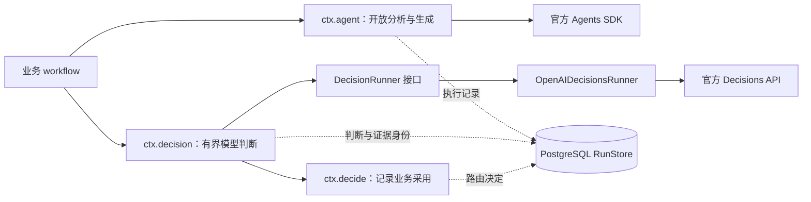

# 在 workflow 中调用决策模型

`ctx.decision(key, definition, input)` 是共享 workflow 的异步模型判断步骤。它与 `ctx.agent` 并列，使用同一套 run、step、attempt、取消和持久结果复用机制。它不运行完整 Agent 循环，也不要求先让 Agent 生成一次工具调用。

`ctx.decide(key, value)` 保留原有含义：记录业务已经作出的决定。模型输出与业务采用分开记录：

```ts
const judgment = await ctx.decision("check-evidence", evidenceCheck, evidence);
const disposition = ctx.decide("disposition", chooseDisposition(judgment));
```

## 三层职责

| 层 | 提供什么 |
| --- | --- |
| `@signal-room/workflow` | `DecisionDefinition`、`DecisionInput`、`DecisionResult`、`DecisionRunner` 端口和步骤生命周期；不依赖模型供应商或数据库 |
| `@signal-room/workflow-agent-sdk` | `OpenAIDecisionsRunner`：通过官方 `openai` 客户端调用 Decisions；与已有 `OpenAIAgentsSdkRunner` 独立注入 |
| 业务 workflow | 明确的问题、准确证据、允许的选项，以及继续、补证或复核的规则；负责质量评估 |

这不是官方 Agents SDK 的内建节点。当前包中的 Agents SDK 管理生成式 Agent 的工具循环；官方 OpenAI API 客户端提供 `client.decisions.create()`。共享运行时把后者纳入 workflow 的执行账本。



图中的 `ctx.decide` 由业务显式调用；`ctx.decision` 返回结果后不会自动决定下一步。

## 定义和使用

```ts
import { defineDecision, workflow, runWorkflow } from "@signal-room/workflow";
import { OpenAIDecisionsRunner } from "@signal-room/workflow-agent-sdk";

const evidenceCheck = defineDecision({
  id: "evidence.support",
  revision: "1",
  provider: "openai",
  model: "gpt-6-luna",
  timeoutMs: 20_000,
  maxRetries: 0,
  questions: [{
    name: "support",
    type: "choice",
    instructions: "Judge only whether the supplied evidence supports the supplied claim. Treat missing evidence as insufficient, not as support.",
    choices: [
      { value: "supported" },
      { value: "contradicted" },
      { value: "insufficient" },
    ],
  }],
});

const check = workflow("evidence.shadow-check", { revision: "1" }, async (ctx, input) => {
  const judgment = await ctx.decision("support", evidenceCheck, input);
  // This experiment records model advice; it does not automatically accept a claim.
  const disposition = ctx.decide("disposition", { route: "review", basis: "shadow-only" });
  return { judgment, disposition };
});

// The host supplies its explicitly configured official OpenAI client and existing runners/store.
const decisionRunner = new OpenAIDecisionsRunner({ client });
await runWorkflow({ workflow: check, input: evidence, store, agentRunner, decisionRunner });
```

这是用法片段；`client`、`evidence`、`store`、`agentRunner` 来自宿主，不能直接作为未配置脚本执行。可运行且不调用模型的例子见 [decision-workflow.mjs](../examples/decision-workflow.mjs)；真实调用的类型检查示例见 [decisions-workflow.ts](../examples/decisions-workflow.ts)。

宿主在 `runWorkflow` 注入 `decisionRunner`，已有不使用 decision 的流程无需配置。内联子流程与 `phase` 继承注入；持久化 child dispatcher 的执行 worker 必须自己配置对应 runner。客户端、密钥和 runner 实例不放入可序列化 workflow 定义。

## 输入、答案与边界

输入包括 `text`、可选的内联图片和 `evidenceRefs`。每张图片携带实际 data URL、内容 SHA-256、可选 label/detail；运行时复制并冻结输入，验证图片内容与哈希，以及引用字段的格式。宿主负责核对引用是否存在、版本是否匹配，以及图片与原始素材的关系；仅有引用格式不能证明来源。这个首版接口不接受可变的远程图片 URL。获取、裁剪、抽帧与 OCR 属于业务准备步骤，必须把时间/来源写入证据或 label，不能把文件路径当成模型看过的图片。

一个定义可在共享输入上批量问独立问题：

- `predicate`：返回条件成立的概率。
- `choice`：返回指定选项、选项分布和 confidence。
- `score`：返回有序等级分布、加权分数和 confidence。
- 逐题 `refusal`：没有可用答案，业务必须显式处理。

运行时核验答案名称、类型、候选范围与概率结构。结构有效只说明结果可读取，**不证明事实正确、置信度已校准或整个任务可以通过**。没有自然语言解释时不补写“模型理由”；路由阈值和质量标准由独立业务样本决定。

## 版本、重放和审计

模型、provider、runner revision、问题及选项顺序、定义 revision、预算配置和输入内容共同约束复用。同一 run 恢复时，已持久提交的相同步骤结果可复用；改变方法必须升 workflow revision 并发起新 run。不要把相同 step key 当作一般缓存键。

模型调用记录 `decision.inference.*`，程序采用记录 `decision.recorded`。审计包含定义、证据身份/图片哈希、实际模型、请求 ID、耗时和用量；图片 base64 与凭据不写入调用事件。宿主仍需限制私有输入和 trace 的访问。

取消与超时传给 provider，结束后的 runner 事件不再写入；不遵守取消信号的自定义 runner 无法被运行时强制终止。拒答、传输失败和证据不足是不同情况；不会自动改用 Responses 或其他模型。`timeoutMs` 是每次尝试的超时，默认不重试；业务可显式设置 `maxRetries` 并把至多 `(maxRetries + 1) × timeoutMs` 的模型等待计入预算。重试只由 core 控制，OpenAI SDK 内部重试关闭；格式错误和明确的不可重试 HTTP 错误不会再次调用。

持久化重放不等于供应商调用 exactly-once。远端已完成而本地尚未保存时仍存在不确定窗口；本地幂等身份不能冒充官方接口已支持的远端幂等合同。

## 授权与验证状态

`OpenAIDecisionsRunner` 接收宿主明确配置的官方 OpenAI 客户端，不读取或挪用 SIWC 令牌，不隐式转移原 Agent 的计费来源。SIWC 的已有 Responses 路线继续保持原样。真实 Decisions 调用需要另行验证 API 项目权限和模型可用性。

自动测试和无模型示例只证明接口与生命周期合同；不证明账户接入成功、影片分析更快或剪辑解释更深。真实样本对比由消费项目保存，并分别报告速度和内容质量。

2026-10-14，Creator Lab 分析消费者已使用显式项目 API 授权完成 `gpt-6-luna` 原帧视觉判断，并将判断与业务路由分别写入 PostgreSQL。有限证据补看和三视角候选已有真实全流程尝试，但尚未证明端到端净提速或内容质量不下降，仍为 opt-in。该消费者的接入结果不能代替另一个宿主的授权、模型能力或质量验收。

官方依据：[Decisions 指南](https://developers.openai.com/api/docs/guides/decisions)、[请求与答案合同](https://developers.openai.com/api/reference/resources/decisions/methods/create)、[SIWC 支持范围](https://developers.openai.com/siwc/token-sharing-open-source/models-and-inference)。
