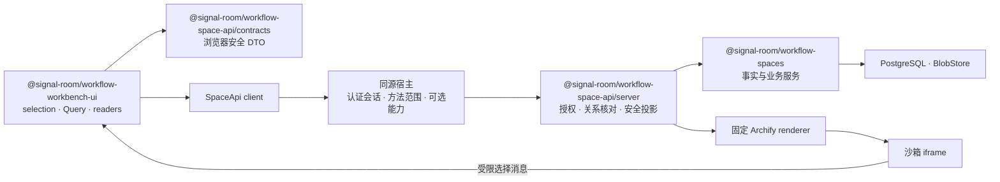

# 工作台与 API 架构

状态：按 2026-10-10 代码核对的现行共享实现。本文说明依赖、信任边界和准确对象如何穿过工作台；产品入口与布局由[工作台展示契约](workbench-presentation.md)定义，交付范围以[建设状态](harness-roadmap.md)为准。2026-10-06 的完整提案保存在同目录 `space-frontend-architecture-history-2026-10-10.md`，其中的拟议 API 表和实现状态不能当作现行接口。

## 从业务生命周期确定边界

Space 服务保存业务目的、准确方法版本、Case、冻结输入清单、Run、节点实例、资产版本和评价等事实。浏览器负责选择和阅读这些对象，不能按名称、时间或列表位置推导“此稿来自哪次运行”。宿主提供认证主体、业务方法作用域、可用部署、业务阅读器和窄命令；共享 API 在每次请求中复核 Space 成员资格与对象关系；领域服务和存储持有事实。对外的产品任务和交互约束见[工作台展示契约](workbench-presentation.md)，不由本文另建菜单规范。

## 现状与复用

共享的 `@signal-room/workflow-space-api` 已有浏览器 DTO 校验出口 `./contracts` 和 Node HTTP 出口 `./server`；`@signal-room/workflow-workbench-ui` 已有 React 工作台、API client、阅读器和图 bridge。creation 宿主在同源地址挂载 API、认证会话与静态包，并注册 CONTENT 的展示和业务能力。它们不是未来待创建的两个包，也不要求 research、analysis 工作台迁移到这套 UI。

当前版本方法图和准确 Run 过程图由保存的合同／过程投影生成。历史方法若没有保存定义，就显示缺失；本次运行的 context、供应商指令和工具事件单列为运行证据，不反填为旧版本冻结 Prompt 或工具合同。图、正文、关系和执行证据是同一组准确对象的不同读法。

## 技术栈决定

UI 包使用 React、TypeScript、Vite、React Router 查询参数和 TanStack Query；creation 的 Space 入口打包共享 UI 的 ESM/CSS。浏览器以 [SpaceApi client](../packages/workbench-ui/src/api.ts) 发同源请求，使用 [Zod DTO contracts](../packages/space-api/contracts.ts) 校验 JSON。服务端 DTO 是有界的浏览器投影，不把 pool、runner、提供者凭据、任意原始对象或可执行 HTML 传给 UI。此处不依赖 CSS Modules、SSR、另一套全局状态库或浏览器直接调用 Space 服务。

## 包与依赖方向

依赖只向右：UI 只导入合同与客户端，不导入数据库、Node HTTP、Space 服务或业务执行器；`contracts` 不导入 server。HTTP host 按请求注入主体及其 principal-bound service，不能把另一个主体的 service 缓存后复用。renderer 使用保存的定义／过程生成授权 HTML；iframe 的点击只返回候选对象 ID，业务读取仍走 HTTP。代码边界见 `packages/space-api/README.md`、[server](../packages/space-api/server.ts)、[工作台入口](../packages/workbench-ui/src/workbench.tsx)和 [Archify renderer](../packages/spaces/archify-render.ts)。

## 路由与对象上下文

现行工作台是宿主提供的页面路径加查询参数，而非旧稿拟议的 `/workbench/spaces/:spaceId/...` 路由树。[selection](../packages/workbench-ui/src/selection.ts) 保存 `view`、`tab`、`version`、`case`、`run`、`node`、`occurrence`、`runtimeAttempt`、`nodePane`、`asset` 等准确身份。选 Run 时取该 Run 的 `caseId` 与 `versionId`；切版本清除不相容的 Run／节点／资产选择。`occurrenceId` 是业务轮次的准确身份，attempt 是该实例的技术尝试，不能互换。资产阅读用准确资产版本 ID；关闭阅读器返回原 Case/Run/节点，刷新可从 URL 重进。

业务理解或设计稿来源追读只接受有界的修订 ID 与来源下标，返回前读取该修订并验证下标；不接收任意返回 URL，也不把本机文件路径变为来源全文入口。[阅读位置](../packages/workbench-ui/src/reading-position.ts)把滚动和展开状态按宿主根路径、主体缓存范围、文档修订或版本／Run／attempt 分区保存在本次浏览器会话中。URL 表示选择，局部 state 表示阅读展开与未提交编辑；后台重取不能把未保存判断当作已登记事实。

方法采用只看宿主声明的 workflow、entrypoint 和 adoption slot；正在查看的版本、最新登记版本、匹配部署的可执行性、采用状态分别投影，互不推断。版本的设计依据是当时冻结的理解与设计修订；旧版本缺失依据时显示缺失，不以当前草案补齐。

## HTTP 合同与授权

实际路径、字段和错误枚举以 `packages/space-api/README.md`、[合同源码](../packages/space-api/contracts.ts)、[服务端路由](../packages/space-api/server.ts)为准；这里不维护第二份端点表。一次请求由宿主解析认证主体与 `cacheScope`，API 先检查该主体仍属于目标 Space，再检查 workflow／entrypoint、Run/Case/资产/会话/修订的准确归属。`404` 历史对象缺失、`409` 关系不符或并发冲突、`401/403` 认证授权问题均是页面可见状态；读取失败不能改称“没有内容”。

列表使用有上限的页和签名游标，游标绑定 Space、主体缓存范围、路由及筛选；`snapshotAt` 是响应时间，不是跨页数据库快照。详情和正文按对象另取，事件按准确 Run/session 或 occurrence/attempt 分页。浏览器列表有界并不表示所有服务查询已是数据库级分页：`packages/space-api/README.md`明确部分目录读取仍会在服务内部加载 Space 概览。需要可复核的集合，应保存准确对象 ID／版本，而不是把滚动目录当冻结快照。

写能力由 summary 的具体 capability、宿主注册和服务端复核共同决定；按钮可见或 aggregate `write` 不能代替授权。同源写请求携带 session 绑定的 CSRF，服务端核对 Origin、token、主体、对象关系及对应动作条件。相应命令按各自合同使用幂等键、预期前值或准确回执；不可在提交结果未知时随意换键重做模型或发布。受信外层 Agent 的身份来自宿主凭据，不由 UI 手填姓名；观察收据只证明准确保存原文曾交付给该 Agent 会话，不代表它已理解或完成独立评价。人的接受、方法采用、登记、执行和一般记录操作仍是不同动作。

API 的 [ScopedReadCache](../packages/space-api/read-cache.ts)按主体、会话范围、Space 和方法范围短期复用读结果，但**每次请求先重新检查成员资格**，拒绝或命令尝试会清理对应范围。浏览器 Query key 也包含主体 `cacheScope` 与准确对象；身份变化／登出清除旧范围，401/403 后不继续展示旧主体缓存的摘要。HTTP 返回 `no-store`，不能把这些内部缓存当公开授权缓存。

## 阅读与图 bridge

三种图语义必须分开：

| 语义 | 当前载体 | 资产与边的事实范围 |
| --- | --- | --- |
| 方法与预期产出 | 已实现的准确版本 Archify 图 | 冻结节点、允许控制路径、声明的输入与预期输出；预期资产不是实际作品 |
| Case/Run 实际过程与资产 | 已实现的准确 Run Archify 图 | 冻结 manifest 输入、已核验发布资产及保存的生产/消费绑定；未发布响应留在失败节点的执行记录 |
| 版本演进 | 当前按准确前驱与历史记录阅读；独立 Archify 谱系图尚未实现 | 只可画明确 predecessor 和证据，不按时间排序造因果边 |

运行图的 [真实资产投影](../packages/spaces/run-graph-assets.ts)只接受该 Run 冻结 manifest 中的资产，以及 output binding 与资产 source context／step／node 互相吻合的已发布输出；只有保存的 input binding 才画消费边。`ProcessDto.graphAssetIds` 把图里可选真实资产的**准确 assetVersionId**交给 UI。预期但未产出的输出、失败作者的未发布响应、范围外资产均不进入这份集合；若有记录缺口，不能画成已证实的边。方法图、运行图复用固定 [Archify viewer](archify-viewer.md)，不在 React 中重写一套图。

[图 bridge](../packages/workbench-ui/src/bridge.ts)只接受活动 iframe 的 `event.source`、已知消息类型与当前 allowlist 中的 ID；运行图额外核对 Space/Run/版本身份后才发送状态。iframe 使用 `sandbox="allow-scripts allow-downloads"`，没有 `allow-same-origin`。向 opaque iframe 发 `postMessage(..., '*')` 只是传递受限选择/聚焦状态，不是授权：点击资产后仍通过同源 API 读正文和关系。选中、收窄或扩大详情不应销毁图的范围；跨页和刷新以 URL 的准确身份恢复对象。

资产正文由冻结展示注册的 reader 或明确回退生成可读 sections，HTML 不作为可执行正文。附件先按准确资产版本读取绑定元数据，再经同源授权路径读取字节；服务端核对版本/blob 绑定及存储完整性，客户端再核对响应 SHA-256、长度和下载字节摘要。[附件阅读器](../packages/workbench-ui/src/asset-attachments.tsx)仅把已验证字节做本地短期 Blob URL，普通附件供下载；不把外部签名 URL、本机路径或 blob ID 单独当持久资产身份。存储边界见[存储架构](storage-architecture.md)。

## 更新、权限与动作

工作台对可见的活动 Run 做有限轮询，终态后不继续按活跃节奏刷新；服务返回原始 task/step 状态、派生失败终态和各自来源，UI 不修改保存的原始步骤。摘要、图、列表与正文可独立加载、失败和重试；局部错误保留已经授权读到的其他区域。若认证范围失效，则先清理旧主体缓存再要求重新读取。历史没有保存方法图、Agent 声明、trace 事件或附件字节时显示各自缺失／不可用，不从当前代码、未保存的模型思考或附件元数据推断内容。

这些边界中，主体范围缓存清理、URL 准确选择、受限图消息、运行终态轮询和若干编辑器的本地草稿状态已有代码实现；“所有未来表单的后台重取都不能覆盖未提交草稿”仍是接入条件，不是一个已由共享 UI 全局强制的机制。当前诊断草稿另有按主体/Run 分区的会话保存与离开提醒；新增编辑器仍须逐项落实并验证。旧稿关于统一 SSE、任意历史运行自动恢复、全站冻结复盘集合的描述也不是现行能力。

**一条完整读取路径：** 浏览器持有 `case=C、run=R`；summary 确认主体和方法范围，Run 详情返回冻结版本与 manifest，过程 DTO 返回实例及 `graphAssetIds`。点击图上的研究资产 `A`，bridge 验证它在本图 allowlist，URL 写入 `asset=A`；资产 reading、关系和附件在同一授权 Space 内分别读取。沿生产/消费关系打开节点，再关闭详情，仍回到 C/R；刷新可恢复准确选择。若 R 的作者发布校验失败，过程可以显示已发布研究 A 与作者的派生失败，作者保存的未发布响应只从该 occurrence 的执行记录入口阅读，**不会**进入 `graphAssetIds` 或显示为正式稿件。响应不存在、会话不属于该 Run、历史图缺失或权限失效时，各读区给出相应错误／未知，不能补一条看似完整的虚构链。

## 生命周期与认知协作

认知 Agent 可通过受信宿主的 skill／CLI 调用同一 Space 服务；前端负责把同一记录连成可阅读的准确上下文，不把聊天记忆、页面状态或主观判断写回为事实。评价、诊断和候选方法的保存修订与执行／采用分开，旧修订仍可精确回读。完整业务生命周期、未交付的运营和交互要求仍见[产品](product.md)、[展示契约](workbench-presentation.md)与[建设状态](harness-roadmap.md)。
