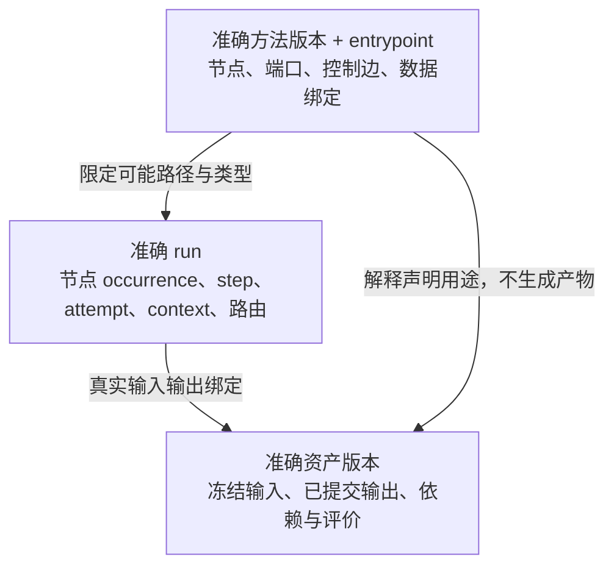

# 方法流程、运行经过与资产关系

一个 Workflow Space 中，同一方法可以处理多个案例，同一个节点也可以在一次运行中出现多轮。要解释「这份结果从哪里来、被谁使用、为何停在这里」，必须同时读三层事实：**方法声明允许什么、准确运行发生了什么、资产和评价连接了哪些准确对象**。三层使用同一组版本、节点、运行和资产身份，但不能互相代替。

本页定义这三层怎样连接。Space 归属、schema 和节点权限见 [Workflow Space](workflow-spaces.md)；界面交互见[工作台展示契约](workbench-presentation.md)；可调用接口与当前限制见 [Space 存储指南](space-storage.md)和[建设状态](harness-roadmap.md)。[2026-10-10 历史快照](workflow-process-assets-history-2026-10-10.md)保存了此前的实用审查、设计推演和实施顺序，不作为现行合同。

<a id="2-通用模型同一件业务的三个层面"></a>
## 三层事实与身份



`workflowVersionId + entrypoint` 指向冻结的方法；`runId` 固定这个版本、一个 Case、一份 `inputManifestId` 和生效配置。`nodeId` 是方法里的稳定节点，`occurrence.id` 是该节点在本次业务中某一轮的经过，`stepRunId` 是执行账本中的技术步骤，`attemptId` 是一次尝试。一个业务轮次可合并 Agent 生成与程序发布两个技术步骤；同一节点返工再进来会形成另一个 occurrence。网络重试增加 attempt，不自动算一轮改稿。

这种分层有一个实际理由：方法定义可能包含尚未发生的分支，而运行会遇到失败、人工介入和未记录的步骤；资产又可能在某一步失败前已经提交。把三者压成一张「最终流程」会同时误报路径、产物和结果状态。

## 方法声明：控制边与数据边分别回答问题

[流程合同](../packages/spaces/process-contract.ts)随准确方法版本冻结。它登记节点类型（Agent、程序、判断、人工、分组）、稳定 ID、输入输出端口、结果角色，以及 `sequence / fork / join / condition / rework` 控制边。返工边必须有遍历预算；其他控制边不能形成无界环。端口引用同版[存储合同](../packages/space-contracts/space-contracts.ts)的槽位和准确 schema，不能为画图另造一个类型表。

控制边回答「**在什么条件下可能走向哪里**」，并不声称某次运行已经通过。例如 `researcher → author` 是允许的顺序；`route → researcher` 是有界返工。数据边回答「**哪一类输入可能来自哪个端口或冻结运行输入**」。`runInputs` 和 `dataBindings` 用受限选择语义（如本运行最近成功、上一业务轮次、冻结输入）声明来源；`when` 区分首次与后续轮次。节点同样接收 Draft schema，并不足以判定消费的是本轮稿、上一稿，还是另一分支的稿。

[预期资产投影](../packages/spaces/expected-assets.ts)把每个声明的运行输入和输出端口投影为**资产类型节点**，保留生产节点、声明的消费者、结果角色、schema 和缺失信息。它的稳定 ID 以 `expected_` 开头，只指方法合同，不是 `assetVersionId`，也不表示已有正文。没有 `dataBinding`、schema 或 storage node 时列出缺口；不按同类型或画面位置补线。方法图因此在零 run 时仍可阅读，却不会伪造作品。

方法版本还冻结节点职责、Prompt、执行器声明、工具及可选来源；历史版本只保存了工具名或未保存细节时，应显示「未记录」。展示名称和阅读器另有展示版本，不能拿当前代码、当前 Prompt 或当前展示定义回填旧方法。保存了方法定义也不保证旧执行工厂仍在部署；能否运行由准确工厂匹配单独判定。

## 运行投影：经过、尝试和未知

[ProcessView](../packages/spaces/process-projection.ts)从保存的 run、step、attempt、NodeContext、输出绑定、决策及事件投影节点 occurrence。`NodeContext.process` 的节点、轮次、分支和路由标注是新运行的直接证据。某些旧运行可由登记的解析器根据确切 step/context 恢复一部分映射；投影分别保留 `observed`、`derived`、`unknown` 来源及 `coverage`，不把事后整理冒充当时冻结的方法。

每个 occurrence 保留它涉及的 step、attempt、context、session、真实输入输出绑定、生命周期事件和状态。一个节点在图上显示最近轮次的摘要，详情仍要保留先前轮次和技术失败。实际路由以保存的决策/事件为据；声明边只表示可能性。没有发生的分支不会得到「已遍历」颜色，缺少事件也不能直接推出「没执行」。未映射 step 要列为 `unmappedStepIds`，而不是从图上消失。

运行图使用同一份方法控制图叠加保存的状态与路由；它不执行 `execute()` 探测路径，也不按时间戳相邻推导因果。对旧运行，如果冻结流程合同不可得，服务应明确历史图缺失或说明回溯来源，不能拿最新方法代画当时图。

## 实际资产：只从保存的版本与绑定连线

[运行资产投影](../packages/spaces/run-graph-assets.ts)以冻结的 `InputManifest.assets` 画本次输入，以 occurrence 的 `outputBindings` 画已经提交的输出。每个图节点的 ID 是准确 `assetVersionId`；输出还需核对资产来源中的 `runId`、`contextId`、`stepRunId`、存储节点身份及所属 Space。消费线只来自真实 `NodeContext.inputs` 投影出的 `inputBindings`。这与方法图的预期类型节点不是一套 ID。运行图不会把方法声明中尚未产生的稿件画成真实资产；一份未通过发布校验但已保存的 Agent 回答属于 session 事件证据，可评价，但不冒充稿件资产。

资产本身有稳定 `assetId` 和不可变版本 ID；[资产来源](../packages/spaces/types.ts)区分导入、节点生产和显式转换，`dependencies` 连接准确上游版本。生产/消费是 context 和输出绑定的事实。业务语义还可由 [relation type 与 mapping](../packages/spaces/relation.ts)说明，例如修订自、评价对象或片段引用：端点必须是准确版本，可带经过校验的 JSON Pointer；声明关系、从绑定验证推导的关系、历史回溯关系保留不同 provenance。不能把所有用途写成 `related-to`，也不能把任意引用都塞入生成依赖。

评价同样连接准确对象。[Review](../packages/spaces/types.ts)可针对资产版本，或针对失败节点中**未发布的准确保存响应**（run、occurrence、step、attempt、session、event 序号与输出 hash）。后一种目标不是 AssetVersion。评价保留判者、标准、四问、证据与独立观察要求；Agent 自评、技术校验通过、人工接受和采用是不同记录。正式采用由独立的 adoption 事件指定准确方法或资产目标，评价不会自动推动指针。

### 一个失败运行的读法

以下 `I1/I2/R1` 是说明用别名，真实系统以资产版本 ID 连接。某次 CONTENT 运行的冻结输入是选题 `I1` 和材料 `I2`；研究节点实际读取二者，提交研究问答 `R1`；写作节点读取 `R1`，但稿件发布前校验失败，保存了 Agent 的回答事件 `E1`。

```text
方法合同：I(选题、材料) → 研究 → 研究输出类型 → 写作 → 稿件输出类型
本次事实：I1 ─┬→ 研究 occurrence 1 ─→ R1 ─→ 写作 occurrence 1 ─→ E1（未发布回答）
             I2 ┘                                      └→ 发布失败，无稿件资产版本
```

方法图可显示「稿件输出类型」；运行图只显示 `I1、I2、R1` 的准确资产节点和已记录的生产消费线。`E1` 在写作 occurrence 的执行证据与未发布响应阅读器中，带准确 hash 供评价；失败运行仍有可读研究，并不意味着有可交付稿件。若下一轮复用 `R1`，应出现另一条真实消费绑定，而不是复制出另一份同名研究。

## 查询与纠错的不变量

- **身份先于标签。** 标题、schema 同名、`latest` 和创建时间都不能替代版本 ID、上下文绑定或 route 事件。
- **声明先于执行，执行先于质量判断。** 方法允许一条边不证明已走过；节点成功不证明业务结果可用；评价通过不证明人接受或已经采用。
- **来源可追、缺失可见。** 无法映射的 step、缺少 dataBinding、未观察到的工具动作和未发布的响应分别表达，不伪造完整覆盖。
- **读写同一事实。** 图、列表、资产阅读和 CLI 共用 ProcessView、保存的版本及关系查询；图的聚焦只改变观察范围，不创建或修正事实。
- **历史不可改写。** 修正历史解释追加有来源的解析或关系事件；已保存的版本、输入 manifest、context、session 和资产正文不因新展示或新方法而变化。

代码入口：[流程合同](../packages/spaces/process-contract.ts)、[运行投影](../packages/spaces/process-projection.ts)、[预期资产](../packages/spaces/expected-assets.ts)、[真实运行资产](../packages/spaces/run-graph-assets.ts)、[关系](../packages/spaces/relation.ts)、[Space API 的 process/graph 读路由](../packages/space-api/server.ts)。消费者怎样登记方法与读取资产见 [Space 存储指南](space-storage.md)；展示方式及其验收边界见[工作台展示契约](workbench-presentation.md)与[建设状态](harness-roadmap.md)。
