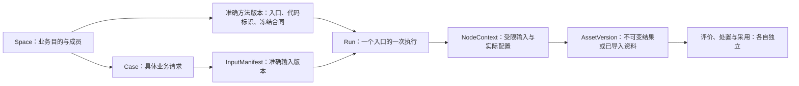

# Workflow Space：业务目的、冻结合同与可追溯资产

**一个 Workflow Space 服务一个长期业务目的。** 它管理这个目的下的方法版本、Case、运行、资产、会话、评价和采用历史；一次运行结束或执行器换机，不会生成一个失去上游关系的新空间。Space 是领域归属与权限边界，不是数据库分区键、本地目录或一台 VM。早期 PostgreSQL 执行账本中的 `workspaceId` 只承担技术分区，不能单独提供这些业务语义。

本页说明 Space 中的对象怎样冻结、交接和受限使用。方法流程与运行资产的投影见[方法、执行与资产关系](workflow-process-assets.md)；当前可调用接口与限制见 [Space 存储指南](space-storage.md)；整体产品方向和状态分别见[产品定义](product.md)与[建设状态](harness-roadmap.md)。[2026-10-10 历史快照](workflow-spaces-history-2026-10-10.md)完整保存此前的业务案例、设计依据和阶段性实施要求。下文提到的 CONTENT → brief → B3 是同一业务空间内的目标交接示例，不表示整条跨阶段生产链已经验收。

## 空间边界：共享历史，不共享无限权限

Space 有稳定 `spaceId`、业务目的、负责人、成员角色和生命周期。一个内容创作 Space 可以容纳 CONTENT 与 B3 等阶段 workflow；一个 Case 是某一期具体需求；phase 只是某个 workflow run 内的执行分组。阶段方法可以独立改版，不能仅因为 CONTENT 与 B3 可分别运行就拆成两个无关联的 Space。只有业务目的、所有权或独立服务边界真的不同，才需要讨论跨 Space 协作；当前合同不预设跨 Space 交接引擎。

同一空间可让操作者跨案例找回研究、稿件、制作资料与评价，但**空间成员资格不等于节点能读取全部内容**。宿主认证的 principal 决定可进入哪个 Space；准确方法版本的存储合同再限制某个节点在本次运行中可读的输入、可提交的输出和可执行动作。节点不能通过请求参数自选另一个 `spaceId`，也不能靠知道版本 ID 阅读其他角色的 session。共享服务负责归属、状态、schema、来源和权限校验，业务定义包负责自己的资产正文和业务读法。

图是对象归属示意，不把评价或采用说成每次运行都必然发生。一个 Case 可有多个 run，使用同一方法或不同方法；一个方法版本也可服务多个 Case。

## 系统记录与业务 schema 如何共同冻结

共享层固定 Space、run、step、attempt、session、资产版本等记录的身份和来源语义。业务 workflow 定义自己的 Research、Draft、Brief 等 `payload` 结构，通过 [Schema Registry](../packages/space-contracts/space-contracts.ts)登记 JSON Schema。一个 schema 引用由 `namespace + revision + hash` 确定；同名同 revision 不同正文必须拒绝。依赖的 schema 闭包在方法发布时解析并冻结，不在旧运行时去远端取「最新版」。业务 schema revision 与 JSON Schema dialect 是两件事；完整 JSON Schema 约定见[官方规范](https://json-schema.org/understanding-json-schema/)。

[WorkflowVersion](../packages/spaces/types.ts)保存准确版本 ID、前驱、变更理由、配置和一个或多个 entrypoint。每个 entrypoint 固定可执行 `workflowId`、`codeRevision`、[storageContract](../packages/space-contracts/space-contracts.ts)、[process contract](../packages/spaces/process-contract.ts)及记录到的方法节点定义；首版设计可另外保存准确设计稿与 Space 理解修订的 ID/hash。发布时服务校验合同引用，生成冻结 hash；重试同 ID 同内容可幂等，内容不同不能覆盖已发布版本。`revision` 是人可读标签，不能替代版本 ID 和 hash。展示名称、布局、阅读器按独立的[展示定义](../packages/spaces/presentation.ts)版本管理，改页面不改方法或资产正文。

存储合同声明每个节点的输入槽、允许状态、可选字段投影、输出槽、必需依赖、是否追加逻辑资产版本、动作和状态规则。原始 Agent 输出 schema 可以不同于程序加工后真正入库的完整资产 schema：模型返回草稿片段，不代表已发布了完整稿件。JSON Schema 验证结构，节点动作与状态变更还要分别经过服务授权；`schema` 合法不等于内容质量合格，更不等于人工确认。

方法已保存也不等于执行包可用。[准确执行工厂](space-storage.md#准确执行器与持久运行任务)必须匹配冻结声明与运行环境；旧版本缺少工厂时仍可读历史，但不能把旧 ID 交给当前代码冒充重跑。改 Prompt、节点、交接或路由应形成新方法版本；只改展示形式不应伪装成方法迭代。旧资产仍按自己的 schema 解释。若新节点只接受 Draft@2，旧 Draft@1 要经过显式转换并保存来源，不能只换标签。

## 从 Case 到一次不可漂移的运行

[SpaceCase](../packages/spaces/types.ts)保存本次题目、目标与约束。材料可以在任何 run 之前导入 Space，来源标为 `import`，无需伪造 Agent attempt。`freezeInputs` 将 `slot → assetVersionId` 保存为有 hash 的 InputManifest；输入可来自导入资料或前次准确产物。`startRun` 固定方法版本、entrypoint、Case、manifest 和生效配置，并用幂等键防止重复启动生成两个 run。此后上游资产出现新版本，不改这次运行已经绑定的输入；下一次运行可以显式选新版本。

一次 run 的业务节点每次进入都要有准确上下文。[NodeContext](../packages/spaces/types.ts)记录 `run/step/attempt/node/session`、实际指令、有效配置、所选知识和每个输入的 `assetVersionId`、schema、状态、正文 hash、交付视图版本与交付内容 hash。它解释「节点实际看到了什么」，而不只是方法模板说它应该看什么。启动节点时服务检查：输入是否在冻结 manifest 或本 run 的已发布输出内、schema 和状态是否符合该节点合同、知识是否属于允许角色/Case。上下文一旦保存，后来的默认配置或新知识不会改写它。

绑定的 [NodeClient](../packages/spaces/types.ts)只允许读取本 context 的槽位和声明的动作。字段投影例如让模拟冷读只看受众能看到的稿件视图；当槽位有投影时，`readFull` 明确拒绝，不能在 Prompt 写「只读正文」却仍给完整 Draft 工具权限。`submit` 校验完整输出 schema、依赖、逻辑资产预期 head、来源和幂等身份；生产者、Space、run、attempt 由受信上下文提供，不让 Agent 自填。人工确认、采用等动作需独立权限，不是节点 `submit` 的副作用。

**Session、attempt 与知识不能混成一个 memory 文件。** Session 记录可观察消息与工具事件，可按明确策略续用或新建；attempt 是一次技术尝试；方法角色定义和有效配置属于不同层。继续原生会话是否可行取决于执行器支持，已有 transcript 不自动成为可恢复检查点。知识修订保留来源、事实/推断分类、适用范围与失效状态，下一轮只选被授权的准确修订并写入 context；不把全空间历史无差别注入模型。凭据仅留受保护引用，不作为可读资产。无法观测的模型内部过程不写成「完整 trace」。

## 资产版本、关系与判决各有身份

[AssetVersion](../packages/spaces/types.ts)是 `assetId` 下的一份不可变版本：准确 schema 引用、payload 与 hash、初始状态、来源、上游依赖和附件清单。导入、受管节点生产、显式转换是不同来源；受管生产版本可追到 run、step、attempt、context 和 session。节点可对同一逻辑资产追加新版本，但必须给出预期 head；多个候选可用不同逻辑资产身份及明确关系保留；同一 `assetId` 只有一个 head，并发追加只有匹配当前 `expectedHead` 的请求能推进，另一个请求会冲突。不能把单 head CAS 写成多头分支，也不能静默覆盖已经采用的对象。状态转移另有规则与记录，不把「最新版本」「候选」「已确认」「已采用」压成同一个布尔值。

附件可由共享 BlobStore 保存并按 hash 校验，资产版本只引用准确字节清单。[当前存储边界](storage-architecture.md)区分 PostgreSQL 元数据和对象字节；历史 PG blob 仍可读，可选私有 R2 路由需宿主显式配置。只有路径、URL 或模型说已生成文件，不等于字节已经持久入库。对象写入和数据库登记之间若中断，重试应按相同 hash/幂等身份核对，不能把未登记的对象宣称为已发布资产。

`dependencies` 表示准确上游版本；NodeContext 输入和输出绑定证明谁在何时消费、生产；有方向和 schema 约束的业务 [relation](../packages/spaces/relation.ts)可表达 `revision-of`、`assesses`、`cites` 及片段指针。它们不能互相代替：一份研究可被三轮写作读取，仍是一份版本、三次消费；上一稿与下一稿的先后时间本身不能证明修订关系。更多投影边界见[方法、执行与资产关系](workflow-process-assets.md)。

[Review](../packages/spaces/types.ts)对准确资产版本，或失败节点已保存但未发布的**准确响应事件**给出判者、标准、四问及证据。未发布响应可以读和评价，但没有 AssetVersion 身份。独立 Agent 评价要有可信宿主身份、确实读取目标的观察收据及与生产者分离的校验；普通表单里填写 Agent 名称不能构成可信判者。对一次 run 的处置、问题诊断和方法候选草案分别追加可追溯记录；`keep / revise / change-method` 之类处置是记录判断，不执行计划、不接受作品。Comparison 与 Validation 将准确基线、条件和全部运行（含失败）相连；Adoption 是另一次有权限的决定，指向准确方法或资产版本。通过技术检查、Agent 评价、人接受和采用都不可自动互推。

### CONTENT → brief → B3 的边界例子

在目标的完整内容创作 Space 中，CONTENT 的研究、稿件与审阅都归属于同一空间和 Case。创作者若确认某份**准确稿件版本**，程序才可形成保留稿件、材料、run 和确认来源的 brief。B3 的另一次 run 冻结这个准确 brief 与附件版本作为输入；CONTENT 后来改稿不会修改 B3 当时用过的 brief。若需制作新版，建立新交接和新 run。制作检查通过也不替代创作者对最终视频的验收。

这个例子说明三件事：阶段连接要声明兼容 schema 与前置状态；人工确认必须绑定具体版本；跨阶段反向反馈应保存为新证据与修改请求，不能覆写旧稿或旧审批。当前单一 CONTENT 的运行与阅读已有局部接入，跨 CONTENT/brief/B3 的完整链及大媒体生产仍以[建设状态](harness-roadmap.md)为准，不能从这段设计推断已交付。

## 必须守住的失败边界

- **同空间不等于同权限。** 成员、执行主体、节点合同和准确 context 都要成立；节点即使收到 brief，也不能顺带读作者私有 session。
- **重试不改历史。** 运行失败、服务重启或对象写入中断后，按原 idempotency 与持久收据对账；不能生成第二个「同一次」run，也不能把未完成提交标成成功。
- **状态、评价与采用分离。** 发布资产不证明执行流程整体成功，run 成功不证明内容质量，独立评价不证明人工接受，采用不抹去旧版本与旧判决。
- **缺失保持缺失。** 旧配置、旧 session、无法恢复的执行包、未登记的附件和未观察的工具动作不得从当前代码、文件时间或 UI 文案补造。
- **保留范围按 Space。** 归档或完成 run 不删除依赖它的资产、评价、会话与知识；清理对象前先核对引用与备份。恢复应能从持久记录读取正文和关系，而不依赖原工作目录。

源码入口：[领域类型](../packages/spaces/types.ts)、[Space 服务与权限](../packages/spaces/service.ts)、[Schema Registry 与冻结存储合同](../packages/space-contracts/space-contracts.ts)、[运行投影](../packages/spaces/process-projection.ts)。API 和部署接入细节由 [Space 存储指南](space-storage.md)维护；本页不把目标跨阶段能力或一次工程测试写成已完成的产品验收。
